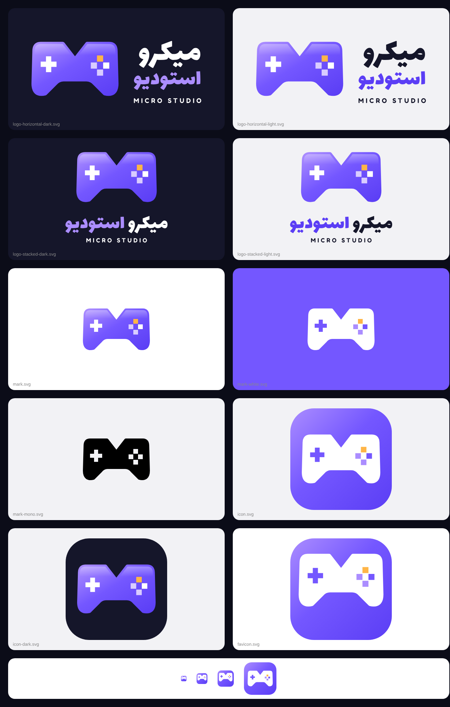

# هویت بصری میکرو استودیو — لوگو



**نشان (M-pad):** یک دسته‌ی بازی که شکل کلی‌اش حرف M است.
- دو دسته‌ی کناری = دو پایه‌ی M
- فرورفتگی وسط بالا = V وسط M
- چپ: یک d-pad سفید پیکسلی
- راست: دکمه‌ها، که یکی از آن‌ها طلایی برند است

**فایل‌های نهایی:** همه در `public/assets/brand/` (روی سایت: `/assets/brand/...`).

| فایل | کاربرد |
|---|---|
| `logo-horizontal-dark.svg` / `.png` | لوگوی افقی برای **زمینه‌ی تیره** (متن سفید و یاسی) |
| `logo-horizontal-light.svg` / `.png` | لوگوی افقی برای **زمینه‌ی روشن** (متن سرمه‌ای و بنفش) |
| `logo-stacked-dark.svg` / `-light.svg` (+ png) | نسخه‌ی عمودی: نشان بالا، نام پایین |
| `mark.svg` / `.png` | فقط نشان، رنگی |
| `mark-white.svg` / `.png` | نشان سفید، برای روی زمینه‌ی بنفش |
| `mark-mono.svg` | تک‌رنگ (`currentColor`)، برای چاپ یک‌رنگ و واترمارک |
| `icon.svg`، `icon-1024/512/192.png` | آیکن اپ و شبکه‌های اجتماعی (زمینه‌ی گرادیان) |
| `icon-dark.svg`، `icon-dark-1024.png` | آیکن روی زمینه‌ی تیره |
| `favicon.svg`، `favicon-32.png`، `apple-touch-icon.png` | آیکن تب مرورگر و iOS |

> PNGها زمینه‌ی شفاف دارند. در SVGها متن به مسیر (outline) تبدیل شده است، پس روی هر سیستمی بدون نصب فونت درست نمایش داده می‌شوند.

## رنگ‌ها
| نقش | کد |
|---|---|
| گرادیان نشان | `#ab8dff` ← `#7457ff` ← `#5b3ef5` |
| بنفش اصلی | `#7457ff` |
| یاسی | `#ab8dff` |
| طلایی (فقط یک دکمه) | `#ffb547` |
| شب (زمینه‌ی تیره) | `#15162a` |
| کاغذ (زمینه‌ی روشن) | `#f2f2f5` |

## فونت‌ها
- **فارسی:** Lalezar
- **لاتین:** Fredoka SemiBold، تمام حروف بزرگ، فاصله‌ی حروف ۰٫۳em

هر دو با مجوز OFL هستند و استفاده‌ی تجاری آزاد است.

## قواعد
- دور نشان دست‌کم به اندازه‌ی ارتفاع d-pad فضای خالی بگذارید.
- نشان را نچرخانید، کش ندهید و رنگ گرادیانش را عوض نکنید.
- روی عکس‌های شلوغ، از نسخه‌ی سفید یا نسخه‌ی روی کادر تیره استفاده کنید.
- حداقل اندازه: نشان ۲۴ پیکسل، لوگوی افقی ۱۲۰ پیکسل عرض.

## ساخت دوباره
فایل‌ها با `build.mjs` (HarfBuzz) و `png.js` (Playwright) ساخته شده‌اند. پیش‌نیازها:
- فایل‌های `Lalezar-Regular.ttf` و `Fredoka-600.ttf` کنار اسکریپت‌ها
- `npm i harfbuzzjs playwright`

```bash
node build.mjs out
```
```bash
node png.js out
```
